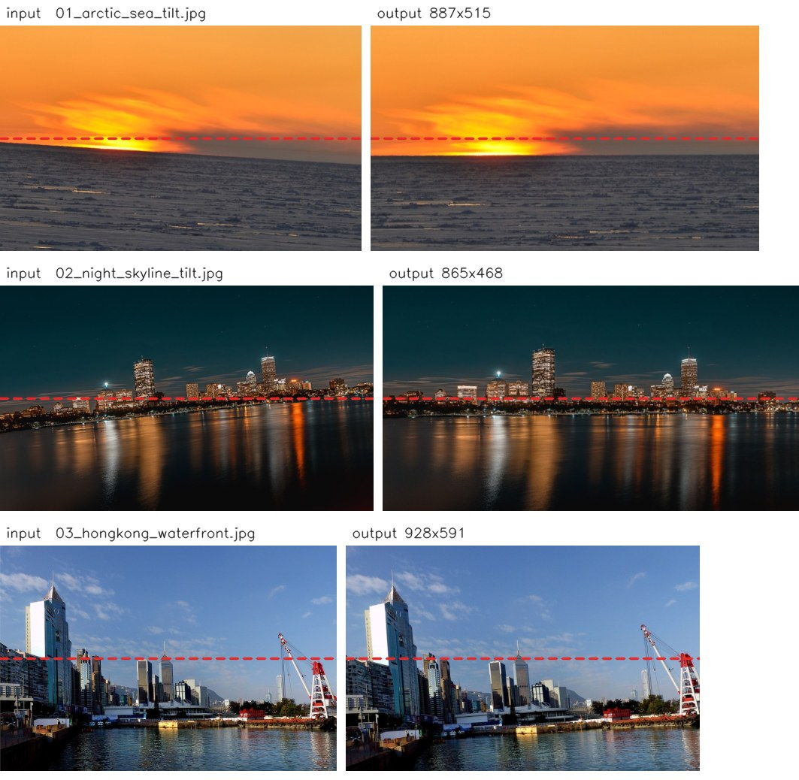
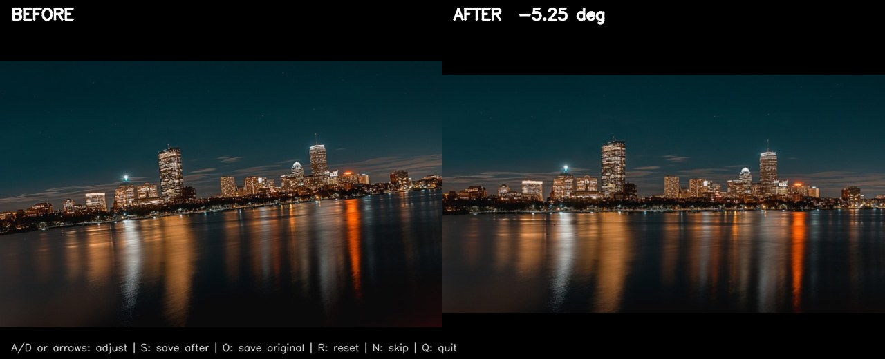
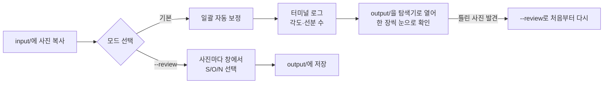
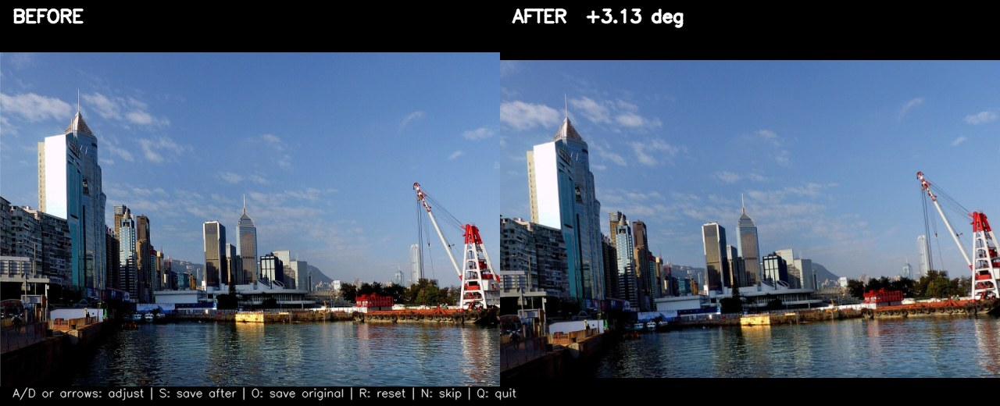
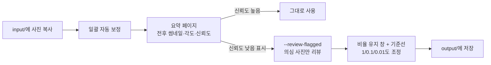

# Auto Photo Leveler

여러 장의 사진에서 수평선을 찾아 기울기를 자동으로 보정하는 OpenCV 기반 도구입니다. `input/`에 사진을 넣고 명령 한 번으로 일괄 보정하거나, 전후 비교 창에서 한 장씩 확인하며 각도를 미세 조정할 수 있습니다.

이 문서는 **현재 사용자 화면과 사용 흐름을 캡처로 보여 주고, 이를 근거로 한 프론트(화면·사용 경험) 개선안**을 중심으로 정리했습니다. 개선안 중 우선순위 1인 리뷰 창 비율(P1)·방향키(P2)는 고쳤고, 나머지는 **계획**입니다.



> 위 캡처는 공개 라이선스 실사진 3장([출처](#사진-출처))을 실제 `auto_level.py`로 처리한 입력·출력입니다. 북극 바다는 -4°, 야경 스카이라인은 +6°를 일부러 기울여 넣었고, 홍콩 부두 사진은 원래 수평인 원본 그대로입니다. 빨간 점선은 수평 확인용으로 비교 이미지에만 덧그린 기준선입니다.

## 한눈에 보기

| 구분 | 내용 |
| --- | --- |
| 문제 | 사진마다 기울기 방향과 크기가 달라 고정 회전값으로 일괄 보정할 수 없고, 한 장씩 손으로 돌리면 시간이 많이 듭니다. |
| 해결 | Canny 에지 → `HoughLinesP` 선분 → 선분 길이 가중 중앙값으로 대표 각도를 구해 회전하고, 회전으로 생긴 빈 모서리는 자동 크롭합니다. 자동 결과가 미덥지 않으면 `--review` 창에서 직접 확인·조정합니다. |
| 규모 | 단일 모듈 `auto_level.py` 563줄, CLI 옵션 7개, 지원 확장자 7종(JPG·JPEG·PNG·BMP·TIF·TIFF·WEBP), 합성 이미지 회귀 테스트 5개 |
| 검증 | 실사진 3장에서 넣은 기울기 대비 오차 `0.26°`(북극 바다)·`0.75°`(스카이라인), 수평인 홍콩 원본은 `+3.13°`로 오탐. 테스트 5개 통과(2026-11-08, Python 3.10.4·OpenCV 4.11.0·NumPy 1.26.4) |

## 현재 화면

### 1. 일괄 보정 CLI

```bash
python auto_level.py --input-dir input --output-dir output --verbose
```

위 비교 이미지를 만든 실제 실행 로그입니다(경로는 줄였습니다).

```text
INFO: Leveled 01_arctic_sea_tilt.jpg -> ...\out\01_arctic_sea_tilt.jpg (angle=+3.74°, lines=11)
INFO: Leveled 02_night_skyline_tilt.jpg -> ...\out\02_night_skyline_tilt.jpg (angle=-5.25°, lines=106)
INFO: Leveled 03_hongkong_waterfront.jpg -> ...\out\03_hongkong_waterfront.jpg (angle=+3.13°, lines=113)
WARNING: Completed: 3 processed, 0 failed
```

- 북극 바다(-4° 기울임)는 `+3.74°`로 거의 되돌렸습니다. 수평선 하나가 분명한 사진이라 선분 11개로도 충분했습니다.
- 야경 스카이라인(+6° 기울임)은 `-5.25°`로 0.75°가 덜 돌았습니다. 건물 윗선·물 반사광 같은 짧은 선분이 대표 각도를 끌어당긴 것으로 보입니다.
- 홍콩 부두는 원래 수평인 사진인데 `+3.13°`로 돌려 오히려 기울였습니다. 왼쪽 부두의 원근선이 수평에 가까운 선분으로 잡혔기 때문으로 보입니다. 선분은 113개로 셋 중 가장 많아, 선분 수만으로는 이 실패를 알아챌 수 없습니다.
- 회전한 사진은 빈 모서리를 잘라내 크기가 줄었습니다(921×574 → 887×515, 906×547 → 865×468, 960×643 → 928×591).

### 2. 전후 비교 리뷰 창 (`--review`)

```bash
python auto_level.py --review --verbose
```



위 화면은 Windows 11에서 실제 리뷰 창을 띄우고 키 입력을 보내 캡처한 것입니다. 왼쪽이 원본, 오른쪽이 현재 각도로 회전·크롭한 미리보기이고, 아래 한 줄에 단축키 안내가 있습니다. 창은 캔버스 크기(1280×520)로 고정되어 비율이 늘어나지 않습니다.

| 키 | 동작 | 2026-11-08 실제 조작 결과 |
| --- | --- | --- |
| `A` / `←` | 각도 `-0.1`(미리보기가 시계 방향으로 돎) | 스카이라인에서 `←` 7번 `-5.25` → `-5.95`, 합성 이미지에서 `A` 1번 `+4.10` → `+4.00` |
| `D` / `→` | 각도 `+0.1`(미리보기가 반시계 방향으로 돎) | `D` 2번 `-5.95` → `-5.75`, 합성 이미지에서 `→` 2번 `+4.00` → `+4.20` |
| `R` | 자동 감지 각도로 되돌리기 | `-5.75` → `-5.25` |
| `S` | 현재 미리보기를 저장 | 저장본이 일괄 처리 결과와 같은 865×468 |
| `O` | 원본을 그대로 저장 | 홍콩 사진 저장본이 원본과 같은 960×643 |
| `N` / `Esc` | 저장하지 않고 다음 사진 | `N`으로 건너뜀(종료 로그 `2 saved, 1 skipped`), `Esc`도 `0 saved, 1 skipped`로 건너뜀 |
| `Q` | 리뷰 종료 | 사진이 남은 상태에서 즉시 종료 |

조정 간격은 `--angle-step`으로 바꿉니다(예: `--angle-step 0.05`).

자동 결과에서 덜 돈 0.75°를 `←` 7번으로 보정한 화면입니다(`-5.95°`, 넣은 기울기 +6°와 0.05° 차이).


### 3. 현재 사용 흐름



일괄 모드는 결과를 한 번에 훑어볼 화면이 없어 사용자가 `output/`을 직접 열어 확인해야 하고, 리뷰 모드는 모든 사진을 처음부터 한 장씩 넘겨야 합니다. 둘 사이를 잇는 "의심스러운 사진만 골라 보기"가 없습니다.

## 프론트 개선안

### 캡처에서 확인한 문제

| # | 문제 | 근거(실제 실행) | 영향 | 상태 |
| --- | --- | --- | --- | --- |
| P1 | 리뷰 창이 미리보기 비율을 지키지 않음 | 1280×520 캔버스가 1114×673 창 영역에 맞춰 가로 0.87배·세로 1.29배로 늘어남. 합성 이미지에서 원으로 그린 해가 80×120 타원으로, 실사진에서는 건물이 세로로 길쭉하게 보임(아래 캡처) | 수평을 눈으로 판단하는 화면에서 형태가 왜곡됨 | **해결**(2026-11-08) |
| P2 | Windows에서 방향키가 동작하지 않음 | `→` 2번 후 각도 변화 없음. 코드가 `cv2.waitKey(0) & 0xFF`의 결과를 81/83과만 비교 | 안내 문구(`A/D or arrows`)와 실제 동작이 다름 | **해결**(2026-11-08) |
| P3 | 자동 결과의 신뢰도가 화면에 없음 | 수평인 홍콩 사진을 `+3.13°`로 잘못 돌렸는데 창에는 각도만 보임(아래 캡처). 선분은 113개로 오히려 가장 많음 | 어떤 사진을 먼저 확인해야 하는지 알 수 없음 | 계획 |
| P4 | 일괄 결과를 한눈에 볼 화면이 없음 | 로그는 파일별 한 줄, 결과는 `output/` 폴더뿐 | 많은 사진에서 틀린 보정을 찾기 어려움 | 계획 |
| P5 | 진행 상황·파일명이 창에 없음 | 창 제목은 항상 `Auto Photo Leveler - Review`, 파일명은 터미널 로그에만 있음 | 몇 장 남았는지, 지금 어떤 파일인지 창만 봐서는 모름 | 계획 |
| P6 | 성공 요약이 `WARNING:`으로 출력됨 | `WARNING: Completed: 3 processed, 0 failed` | 정상 종료가 경고처럼 보임 | 계획 |
| P7 | 자동 크롭을 끌 수 없음 | `rotate_image(crop=False)`는 있지만 이를 켜는 CLI 옵션이 없음 | 가장자리가 중요한 사진도 항상 잘림 | 계획 |

P1 수정 전 리뷰 창입니다. 같은 스카이라인이 1114×673 창에 맞춰 세로로 늘어나, 위 고정 창 캡처보다 건물이 길쭉합니다.


P3 사례입니다. 원래 수평인 사진을 `+3.13°` 돌려 오른쪽 미리보기가 오히려 기울었지만, 창에는 이 결과를 의심할 단서가 없습니다. 이 사진은 `O`로 원본을 저장해야 합니다.



이전 README는 `D`를 "시계 방향"이라고 설명했지만, 캡처에서 `D`는 미리보기를 반시계 방향으로 돌렸습니다. 문서만 바로잡았고 키 배치는 바꾸지 않았습니다.

### 개선 계획

우선순위 1의 두 항목은 **완료**, 나머지는 **계획**입니다. 진행 상황은 [TODO.md](TODO.md)에서 관리합니다.

| 우선 | 개선안 | 해결하는 문제 | 참고 근거 |
| --- | --- | --- | --- |
| 1 | **완료**: 리뷰 창을 `cv2.WINDOW_AUTOSIZE`로 캔버스 크기에 고정. 처음 계획한 `WINDOW_KEEPRATIO`는 Qt 백엔드 전용이라 pip OpenCV(Win32 백엔드)에서 효과가 없었음 | P1 | 비교 화면의 기본 조건이라 별도 참고 없이 수정 |
| 1 | **완료**: 방향키를 `cv2.waitKeyEx`로 받아 Windows·Linux GTK·macOS 방향키 코드를 처리 | P2 | 〃 |
| 2 | 미리보기 위 수평 기준선 격자 표시(키로 켜고 끔) | 수평 판단 보조 | MobyCAIRO는 회전 단계에 에지 보기 화면을 따로 제공 |
| 2 | 선분 수·각도 분산으로 신뢰도를 계산해 낮으면 창과 로그에 경고 표시 | P3 | ScanTailor Advanced는 기울기가 지나치게 큰 페이지를 빨간색으로 강조 |
| 2 | 조정 단위 전환(1 / 0.1 / 0.01도) | 큰 오차를 0.1도씩 고치는 반복 | MobyCAIRO는 1·0.1·0.01도 단위 미세 조정 제공 |
| 2 | 창 제목·상단에 `2/3 · 02_night_skyline_tilt.jpg · 선분 106개` 표시 | P5 | ScanTailor Advanced의 페이지 썸네일·탐색 |
| 3 | 실행 후 전후 썸네일·각도·신뢰도를 모은 HTML 요약 페이지 생성 | P4 | Upscayl은 전후 비교를 별도 문서로 제공, ScanTailor Advanced는 다중 열 썸네일 보기 제공 |
| 3 | `--review-flagged`: 신뢰도가 낮은 사진만 리뷰 창으로 열기 | P3·P4 | unpaper README는 자동 처리가 실패할 수 있으니 결과를 직접 확인하라고 안내 |
| 3 | `--dry-run`(각도만 출력)과 `--debug-images`(에지·검출 선분 저장) | 감지 근거 확인 | sbrunner/deskew는 `deskew input.png`로 각도만 출력하고, 디버그 이미지 생성 기능 제공 |
| 3 | `--no-crop` 옵션 | P7 | RotNet은 `-c, --crop`으로 크롭을 선택 사항으로 둠 |
| 3 | 성공 요약을 `WARNING` 대신 일반 출력으로 | P6 | 별도 참고 없이 수정 |
| 4 | 웹 UI(드래그 앤 드롭·전후 슬라이더·각도 조정) | 설치·조작 장벽 | Upscayl은 CLI 대신 데스크톱 GUI 앱으로 제공. 기존 개선 계획을 유지 |

### 개선 후 목표 흐름 (계획)



## 참고한 프로젝트

GitHub에서 deskew, 이미지 회전 보정, 수평선 검출, 이미지 처리 도구를 찾아 README 구성과 화면 설계를 비교했습니다. 스타 수는 2026-11-08에 `gh api repos/<owner>/<repo>`로 조회한 값입니다.

| 프로젝트 | 스타 | 성격 | 가져온 점 |
| --- | ---: | --- | --- |
| [upscayl/upscayl](https://github.com/upscayl/upscayl) | 51,941 | AI 이미지 업스케일 데스크톱 앱 | README 상단 대표 이미지, 전후 비교를 별도 문서로 분리 |
| [4lex4/scantailor-advanced](https://github.com/4lex4/scantailor-advanced) | 1,580 | 스캔 페이지 후처리 GUI(deskew 포함) | 다중 열 썸네일, 기울기가 큰 페이지 빨간 강조, 일괄 처리 멀티스레드 |
| [unpaper/unpaper](https://github.com/unpaper/unpaper) | 1,206 | 스캔 페이지 후처리 CLI(deskew 포함) | 자동 처리 실패 가능성을 문서에 명시하고 수동 확인을 권장 |
| [d4nst/RotNet](https://github.com/d4nst/RotNet) | 578 | CNN 기반 사진 회전 각도 예측 | 크롭을 `-c` 옵션으로 선택하게 함 |
| [sbrunner/deskew](https://github.com/sbrunner/deskew) | 529 | 문서 기울기 감지 라이브러리·CLI | README의 전후 비교 표, 각도만 출력하는 CLI, 디버그 이미지 |
| [multimediamike/MobyCAIRO](https://github.com/multimediamike/MobyCAIRO) | 31 | 이미지 수평 보정·크롭 GUI | 스타는 적지만 화면이 가장 비슷해 보조로 참고: 후보 각도 선택, 1·0.1·0.01도 조정, 에지 보기 |

## 도전과 해결

- **개인 사진 없이 실사 화면을 보여 주기**: 저장소에는 개인 사진을 올리지 않는 원칙이 있습니다. 처음에는 기울기를 알고 만든 합성 이미지를 썼는데, 감지 각도가 넣은 기울기를 정확히 되돌려(+4.00°, -6.00°) 오히려 실제 사용에서 무엇이 문제인지 드러나지 않았습니다. 그래서 Wikimedia Commons의 퍼블릭 도메인·CC0 실사진으로 바꿨고, 그러자 0.75° 덜 도는 스카이라인과 수평 사진 오탐(P3) 같은 실제 한계가 보였습니다.
- **리뷰 창은 실제로 띄워 캡처**: OpenCV 창은 키 입력을 기다리며 멈추므로, 별도 프로세스로 실제 `--review`를 실행하고 창에 키 메시지를 보내며 캡처했습니다. 이 과정에서 방향키 미동작(P2)과 비율 왜곡(P1)을 발견했습니다. 캔버스 함수만 호출해 이미지를 저장했다면 둘 다 보이지 않았을 문제입니다.
- **계획대로 고쳤는데 다시 늘어남(P1)**: 처음 계획은 `WINDOW_KEEPRATIO`와 시작 시 `resizeWindow`였습니다. 열 때는 맞았지만 창 크기를 바꾸면 다시 늘어났고, 확인해 보니 pip OpenCV의 GUI 백엔드는 `WIN32UI`이고 `WINDOW_KEEPRATIO`는 Qt 백엔드 전용이었습니다. 창을 캔버스 크기에 고정하는 `WINDOW_AUTOSIZE`로 바꿨고, 대신 리뷰 창 크기는 조절할 수 없습니다.
- **수정 전후를 같은 조건에서 비교**: OpenCV는 Windows 레지스트리(`HKCU\Software\OpenCV\HighGUI\Windows\<창 이름>`)에 마지막 창 크기를 저장했다가 다음 실행에 다시 씁니다. 수정 후 코드를 먼저 실행하면 수정 전 코드도 1280×520으로 열려 문제가 사라진 것처럼 보였습니다. 그래서 매 실행 전에 저장된 크기를 1136×729(화면 영역 1114×673)로 되돌리고 비교했습니다.
- **방향키 코드가 글자와 겹침(P2)**: 기존 코드는 `waitKey & 0xFF`를 81/83과 비교했는데, 이는 Linux 방향키 코드의 하위 바이트이자 대문자 `Q`·`S`의 코드입니다. Windows 방향키(2424832/2555904)는 하위 바이트가 0이라 잡히지 않았습니다. `waitKeyEx` 원본 코드로 방향키를 먼저 판별하고, 하위 16비트에 특수 키 표시(0xFF00)가 있으면 글자로 해석하지 않게 했습니다(Linux 위쪽 방향키 65362가 `R` 리셋으로 오인되는 것 방지).
- **문서와 실제 동작의 차이**: 키 방향 설명(`D`=시계 방향)이 실제와 반대였습니다. 코드는 그대로 두고 README만 실제 동작에 맞췄습니다.

## 동작 원리

1. `input/`에서 지원 확장자 파일을 찾습니다(`--recursive`면 하위 폴더 포함).
2. grayscale 변환 후 Gaussian Blur로 작은 노이즈를 줄이고, Canny로 에지를 추출합니다.
3. `HoughLinesP`로 선분을 찾고 `--max-angle`(기본 45°)보다 가파른 선은 제외합니다.
4. 선분 길이를 가중치로 한 weighted median으로 대표 기울기를 정합니다. 짧은 글자·잡음 선분의 영향이 줄어듭니다.
5. 캔버스를 넓혀 회전한 뒤, 빈 모서리가 없는 가장 큰 사각형으로 자동 크롭합니다. 선분이 없으면 0°로 두어 원본을 유지합니다.
6. 결과를 원본 파일명으로 `output/`에 저장합니다. 읽지 못한 파일은 실패 목록에 남기고 다음 파일을 계속 처리합니다.

## 실행 방법

```bash
python -m venv .venv

# Windows PowerShell
.\.venv\Scripts\Activate.ps1

pip install -r requirements.txt
```

보정할 사진을 `input/`에 넣고 실행합니다.

```bash
python auto_level.py --verbose                      # 일괄 보정
python auto_level.py --review --verbose             # 전후 비교 리뷰
python auto_level.py --review --angle-step 0.05     # 조정 간격 변경
python auto_level.py --input-dir my_photos --output-dir leveled --recursive
python auto_level.py --max-angle 30
```

| 옵션 | 기본값 | 설명 |
| --- | --- | --- |
| `--input-dir` | `input` | 원본 사진 폴더 |
| `--output-dir` | `output` | 결과 저장 폴더 |
| `--recursive` | 꺼짐 | 하위 폴더까지 검색 |
| `--max-angle` | `45` | 이보다 가파른 선은 무시(0 초과 90 이하) |
| `--verbose` | 꺼짐 | 파일별 처리 로그 출력 |
| `--review` | 꺼짐 | 전후 비교 창에서 한 장씩 확인·저장 |
| `--angle-step` | `0.1` | 리뷰 창의 `A`/`D` 조정 간격(도) |

## 테스트

```bash
python -m unittest discover -s tests -v
```

합성 이미지로 각도 정규화, 기울기 추정, 회전 캔버스 확장, 기본 크롭, 폴더 일괄 저장을 확인합니다. 2026-11-08 실행 결과 5개 모두 통과했습니다.

## 한계

- 수평선이나 수평에 가까운 긴 에지가 거의 없는 사진은 기울기를 안정적으로 추정하기 어렵습니다.
- 건물·표지판·책상처럼 다른 수평 구조가 실제 지평선보다 강하면 그 구조를 기준으로 보정할 수 있습니다.
- 원근 왜곡, 렌즈 왜곡, 곡선 지평선은 보정하지 않습니다.
- 자동 크롭은 끌 수 없어, 회전 각도가 클수록 가장자리가 더 많이 잘립니다.
- 실사진 정확도는 공개 사진 3장으로만 확인했습니다. 홍콩 부두처럼 원근선이 강한 사진은 수평 사진도 잘못 돌립니다.
- 리뷰 창 조작은 Windows 11 한 환경에서, 실제 키보드가 아니라 창에 키 메시지(`WM_KEYDOWN`·`WM_CHAR`)를 보내 확인했습니다. Linux·macOS 방향키 코드는 키 변환 함수에 값을 넣어 본 것만 확인했고 실제 창 동작은 확인하지 않았습니다.
- 리뷰 창은 캔버스 크기(1280×520)로 고정되어 마우스로 크기를 바꿀 수 없습니다. 이보다 좁은 화면에서는 창이 잘릴 수 있습니다.
- `--recursive`·`--max-angle` 옵션은 이번에 직접 실행하지 않았습니다.
- 개선안 중 P1·P2 외 항목은 계획이며 구현되지 않았습니다.

## 사진 출처

`docs/readme/`의 실사 캡처는 아래 공개 사진을 가로 960px로 줄인 뒤, 1·2번은 일부러 기울여 만든 것입니다. 라이선스는 2026-11-08 Wikimedia Commons API(`extmetadata.LicenseShortName`)로 확인했습니다.

| 파일 | 원본 | 작성자 | 라이선스 |
| --- | --- | --- | --- |
| `01_arctic_sea_tilt.jpg` | [Arctic Sunset (4371015788).jpg](https://commons.wikimedia.org/wiki/File:Arctic_Sunset_(4371015788).jpg) | U.S. Geological Survey | 퍼블릭 도메인 |
| `02_night_skyline_tilt.jpg` | [Bright skyline over water (Unsplash).jpg](https://commons.wikimedia.org/wiki/File:Bright_skyline_over_water_(Unsplash).jpg) | Osman Rana | CC0 |
| `03_hongkong_waterfront.jpg` | [Hong Kong waterfront.. (23887062414).jpg](https://commons.wikimedia.org/wiki/File:Hong_Kong_waterfront.._(23887062414).jpg) | Bernard Spragg. NZ | CC0 |

P1 원 왜곡 수치(80×120 → 92×93)와 `A`·`Esc`·`→`의 일부 결과는 원을 그려 넣은 합성 이미지로 측정했습니다. 원은 늘어난 정도를 숫자로 재기 쉽기 때문입니다.

## 폴더 구조

```text
.
├── auto_level.py       # CLI, 이미지 보정 로직, 리뷰 창
├── docs/readme/        # README 캡처(공개 라이선스 실사진으로 생성)
├── input/              # 원본 사진을 넣는 곳 (사진은 Git에서 제외)
├── output/             # 보정 결과가 저장되는 곳 (결과물은 Git에서 제외)
├── examples/           # 사용 예시 안내
├── tests/              # 자동 테스트
├── requirements.txt
├── TODO.md             # 작업 현황
└── README.md
```

## Git 관리 원칙

개인 사진과 자동 생성된 보정 결과는 `.gitignore`에서 `input/`·`output/` 아래를 제외하도록 설정했습니다. 저장소에는 폴더 유지용 `.gitkeep`만 남기고 사진 파일은 커밋하지 않습니다. `docs/readme/`의 이미지는 [사진 출처](#사진-출처)의 퍼블릭 도메인·CC0 사진과 그 처리 결과이며, 개인 사진은 쓰지 않았습니다.
